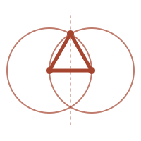

<p align="center"></p>

# Disegno

Un linguaggio totale, con tipi dipendenti, per CI/CD e infrastruttura. Progetta, non esegue: un programma Disegno dichiara un piano, il type checker ne prova le proprietà, [Dagger](https://dagger.io) lo realizza.

```
(def go-build : (→ Dir Dir)
  [src] (let [root /src, out /out, bin (/ out "hello")]
          (pipe (container)
                (from "golang:1.25-alpine")                       ; un Image, verificato
                (with-mounted-cache /go/pkg/mod (cache-volume "go-mod"))
                (with-dir root src)
                (with-workdir root)
                (with-exec ["go" "build" "-o" bin "."])
                (dir-of out))))

(def main : (→ [src (Host "hello")] (Export Dir))
  [src] (overlay "bin" (go-build src)))

; teoremi, non linter: valgono per ogni sorgente
(def montaggi-disgiunti : (→ [src Dir] (Disjoint-mounts (go-build src)))
  [src] auto)
```

- **Totale**: niente ricorsione generale, copertura dei casi, universi stratificati, positività; un kernel ricontrolla ogni termine.
- **Il piano è un dato**: le operazioni del motore sono costruttori di un tipo induttivo, generati dallo schema di Dagger. Le regole che oggi stanno in linter e policy (immagini pinnate, test prima di publish, montaggi disgiunti) sono teoremi, provati per calcolo con `auto`.
- **I punti non si sommano**: i letterali si leggono secondo il tipo atteso (`"golang:1.25-alpine"` è un `Image`, `/out` è un punto); punto più punto è un errore di tipo.
- **Due tempi**: `if` decide mentre si costruisce il piano, `branch` durante l'esecuzione, su osservazioni del motore.

## Uso

Serve [Nix](https://nixos.org) con i flake, e Docker per il motore Dagger.

```
nix run github:avit-io/disegno -- check prog.disegno   # disegno interno: tipi e teoremi
nix run github:avit-io/disegno -- plan  prog.disegno   # disegno esterno: il piano, in GraphQL
nix run github:avit-io/disegno -- run   prog.disegno   # opera: l'esecuzione su Dagger
```

In un terminale `run` mostra la TUI di Dagger. In CI (variabile `CI`) o senza terminale la TUI tace e `disegno` stampa l'output di ogni `with-exec`, un gruppo per passo: richiudibile su GitHub Actions (`::group::`) e GitLab (`section_start`), con un'intestazione `──` altrove. Un passo fallito chiude con `passo fallito (exit N): comando`, e su GitHub anche con un'annotazione `::error::`.

Per imparare il linguaggio c'è [Pointless Disegno](book/README.md), un libricino sui tipi dipendenti. Per vederlo in azione c'è il [cookbook](cookbook/README.md): sette ricette brevi, dalle basi alla rete come dato. Dal repository, `nix run . -- run cookbook/02-go-build.disegno` compila l'esempio Go e scrive il binario in `cookbook/bin/`. In `nix develop` c'è il comando `disegno`, e i test sono `scheme --script tests/test.ss` (dal vivo: `dagger run scheme --script tests/test.ss`).

```
src/       il nucleo e il driver          lib/    la libreria standard (engine è generata dallo schema)
tests/     test e teoremi di controllo    tools/  il generatore      cookbook/  gli esempi
```

## Editor

Un solo binario, `disegno`, fa anche da server LSP (`disegno lsp`: diagnostica all'apertura e al salvataggio, hover con i tipi) e risponde a `disegno type prog.disegno nome`. Per Neovim il flake dà il plugin `nvim-disegno`: filetype `.disegno`, evidenziazione con tree-sitter, LSP, e `:make` con la quickfix. Con home-manager:

```nix
# inputs.disegno.url = "github:avit-io/disegno";
home.packages = [ inputs.disegno.packages.${pkgs.system}.default ];
# un pacchetto di Neovim caricato all'avvio, anche con lazy.nvim
xdg.dataFile."nvim/site/pack/disegno/start/disegno".source = inputs.disegno.packages.${pkgs.system}.nvim-disegno;
```

Con `programs.neovim` basta aggiungere `nvim-disegno` a `programs.neovim.plugins`. La grammatica sta in `editors/tree-sitter-disegno` (pacchetto `grammar`), per altri editor.

Il progetto, le scelte e le questioni aperte sono in [DESIGN.md](DESIGN.md). È un esperimento: l'ospite è Chez Scheme, il motore Dagger 0.21.

Il logo è la prima proposizione degli *Elementi*: il triangolo equilatero costruito con due cerchi, una costruzione che è anche una prova. È tracciato in sanguigna, il colore del disegno rinascimentale.
